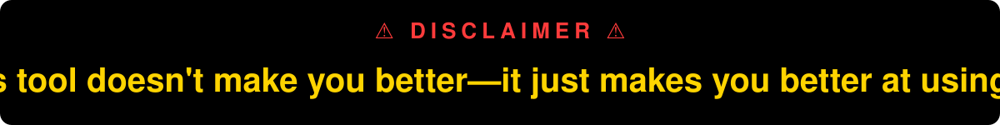

<p align="center">
  
</p>

# devops-ai-kit

> Vietnamese version: [README.vi.md](README.vi.md)

Rules, skills, subagents and guardrails that make Claude Code safer and more useful for DevOps / cloud infrastructure work (Kubernetes, Terraform/OpenTofu, Ansible, Helm, Argo CD, Azure/AWS/GCP, on-prem).

Full guide: [docs/en/guide.md](docs/en/guide.md) · Terms: [docs/en/glossary.md](docs/en/glossary.md) · Read-only cloud identity: [docs/en/cloud-readonly.md](docs/en/cloud-readonly.md)

## What's inside

| Layer | Contents | How it loads |
|---|---|---|
| Rules | `00-core` (safety, risk levels L0–L3, evidence, docs), `01-language` (output language) + Terraform, Ansible, Kubernetes, Helm, Argo CD, Dockerfile, observability | `00-core` and `01-language` always; the rest through `paths:` when matching files are touched |
| Skills | `/infra-task` workflow, `grill-me` (asks you questions until the context is complete), `infra-docs` (change record, concept note, runbook, ADR, postmortem), 8 design-standard skills, 3 playbooks (monitoring stack, PostgreSQL migration with PGO, AKS) | On demand (description match or slash command) |
| Subagents | `infra-recon`, `infra-researcher`, `infra-reviewer`, `infra-verifier`, `infra-scribe` | Called by `/infra-task` or on request |
| Guardrails | Permission rules (deny/ask/allow), a PreToolUse hook that shows the real target (context, namespace, workspace, subscription) on every mutating command, read-only RBAC + kubeconfig generator for the AI | Enforced by Claude Code / Kubernetes, not by the model |

## Quick start

```bash
git clone https://github.com/hoangminhung/devops-ai-kit.git ~/devops-ai-kit && cd ~/devops-ai-kit
./install.sh --dry-run        # preview, writes nothing
./install.sh --lang en        # install into ~/.claude (use --lang vi for Vietnamese docs and reports)
./check.sh                    # status, output language, which gate tools are installed
```

Then start a new Claude Code session and check with `/context`, `/skills`, `/agents`, `/permissions`, `/hooks`.

`--lang` sets the language of handover docs and agent reports: `en` (default) or `vi`. README, PR descriptions, commit messages and code comments are always English. Chat follows the language you write in. A re-install without `--lang` keeps your earlier choice.

**Strongly recommended next step:** give the AI a read-only kubeconfig.

```bash
setup/k8s/make-ai-kubeconfig.sh --apply-rbac --readonly <prod-context> --passthrough <dev-context>
./install.sh --env KUBECONFIG=~/.kube/ai-config
```

For cloud CLIs (Azure / AWS / GCP), see [docs/en/cloud-readonly.md](docs/en/cloud-readonly.md).

## Day-to-day

- L0/L1 work: prompt as usual; the rules apply automatically.
- Not sure what to ask for, or Claude lacks context: `/grill-me <topic>`. Claude asks short rounds of questions, each with a recommended answer.
- Long-running projects: keep a `PROGRESS.md` (template in `templates/`). Claude reads it at the start of each session and updates it after each task, so nothing is lost when a session ends.
- L2/L3 work: `/infra-task <description>` → recon → research → plan → review → **approval gate** → implement → review → **approval gate** → execute → verify → docs. Resume at any time with `/infra-task resume <task-folder>`.

## Layout

```
devops-ai-kit/
├── install.sh · uninstall.sh · check.sh
├── claude/                  # installed into ~/.claude/
│   ├── rules/devops-kit/    # 00-core + 7 technology rules
│   ├── lang/                # en.md, vi.md → 01-language.md
│   ├── skills/              # 14 skills
│   ├── agents/              # 5 subagents
│   ├── hooks/devops-kit/    # infra-context-guard.py
│   └── settings.devops-kit.json
├── scripts/                 # kit.py (installer), run-kit.sh, validate.py
├── setup/k8s/               # read-only RBAC + AI kubeconfig script
├── templates/               # project CLAUDE.md, PROGRESS.md, .gitignore additions
├── tests/                   # hook and installer tests
└── docs/{en,vi}/            # guide, glossary, cloud read-only setup
```

## Update / uninstall

Edit files in this repo (not in `~/.claude`), or `git pull`, then run `./install.sh` again. `./uninstall.sh` removes everything the kit added, including its `settings.json` entries. If you did not change `settings.json` after install, you get the original file back byte for byte.

## Development checks

```bash
python3 scripts/validate.py                  # frontmatter, names, paths, lengths, references, leftover Vietnamese
python3 -m unittest discover -s tests -v     # hook + installer tests (temp HOME)
shellcheck -S warning *.sh scripts/*.sh setup/k8s/*.sh
```

CI (`.github/workflows/ci.yml`) runs the same checks once on every pull request to `main`. `main` is protected: the merge button stays disabled until CI passes.

## How this differs from other kits

GitHub already has many DevOps skill sets for Claude Code, and many hooks that block risky `kubectl` / `terraform` commands. This kit does not try to replace them. What it adds is the combination:

- an infrastructure change workflow (`/infra-task`) with two human approval gates;
- recon, review and verify agents that work in their own context;
- task folders you can resume across sessions and machines;
- handover docs with evidence markers (✅ checked · 📖 from docs · ⚠️ guess);
- read-only RBAC and kubeconfig for the AI, so safety does not depend only on the model;
- playbooks for Longhorn, Crunchy PGO migration and AKS;
- docs in English and Vietnamese, with Vietnamese output as an install option.

## Requirements

Claude Code (recent version), Python 3.8+, bash (Git Bash or PowerShell on Windows). Gate tools are optional but recommended: `kubeconform`, `tflint`, `trivy`, `ansible-lint`, `promtool`, `amtool`, `hadolint`, `infracost`, `helm-diff`. Run `./check.sh` to see what is missing.

## License

[MIT](LICENSE)
