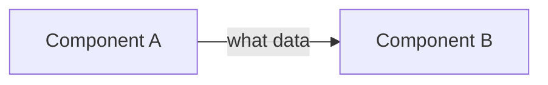

# <Technology / tool name>: how it works

- **Applies to:** <tool> <version> (on <environment, if special>)
- **Updated:** <YYYY-MM-DD>
- **Read first:** <concepts to know first, links to other concept notes>
- **Legend:** ✅ checked with a command · 📖 from the official docs · ⚠️ guess, not checked

## 1. One-paragraph summary

<What it is, what problem it solves, where it sits in our system.>

## 2. Mental model

<Compare it with something the reader already knows. Example: "Longhorn is like RAID-1 spread over many nodes: each volume has N copies on N different nodes, and an engine in front writes to all copies at the same time.">

## 3. Components & flow

| Component | Role | Where it runs (Deployment/DaemonSet/...) | What happens if it breaks |
|---|---|---|---|

<Describe one typical flow from start to end, e.g. "how one log line goes from a pod to Grafana".>

## 4. Important settings

| Setting | Default | Our value | Why it matters |
|---|---|---|---|

**Dangerous / confusing defaults:**
- <e.g. the default reclaimPolicy is Delete → deleting the PVC deletes the data>

## 5. Common failures & how to debug

| Symptom | Common cause | Check with | Fix |
|---|---|---|---|

## 6. Day-2 operations

- **Upgrade:** <upgrade path, version notes, CRDs>
- **Backup / restore:**
- **Scale:**
- **Monitoring:** important metrics / alerts / dashboards

## 7. Terms

| Term | Meaning |
|---|---|

## 8. Self-check questions (for new people)

1. <question that checks the mental model>
2. <question about a failure mode>
3. <scenario question: "if X happens, what do you check first?">

## 9. References

- 📖 <official docs link, for the right version>
- <other link>
