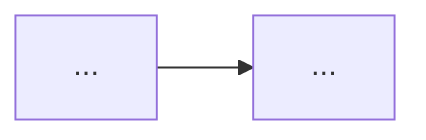

# Plan: <task name>

- **Risk level:** L2 | L3 — <reason>
- **Environment & target:** context `<...>` · namespace `<...>` · subscription/account `<...>` · terraform workspace `<...>`
- **Standards & playbooks used:** <list of skills, e.g. playbook-pg-migration, db-reliability, disaster-recovery>
- **Related versions:** <from 01-recon / 02-research, e.g. Kubernetes 1.3x, PGO 5.x, PostgreSQL 16, Longhorn 1.x>
- **Status:** Draft | Reviewed | Approved (<date, approved by>)

## 1. Goal & scope

- **Goal (measurable):**
- **In scope:**
- **Out of scope:**

## 2. Current state (summary)

<5–10 lines from 01-recon.md; only what affects the plan>

## 3. Design / options

- **Chosen option and why:**
- **Options considered and rejected:**
- If there is an architecture decision worth keeping long term → mark `ADR: needed`.

## 4. Prerequisites

- [ ] <e.g. the latest backup of X was test-restored successfully at <place> at <time> (required for L3)>
- [ ] <e.g. DNS TTL lowered to 60s at least 1 old TTL before>
- [ ] <e.g. the team / system users have been told>

## 5. Steps

<!-- One checkbox line per step, with its details indented below it.
     In Phase 7, tick a step only after its verify passes, with scripts/plan_status.py tick, which writes:
       - [x] Step 2: <short name> — ✅ <YYYY-MM-DD HH:MM> UTC · <short result>
     Never renumber steps. A step added later gets a letter (Step 3b). Ticked steps are history: do not edit them. -->

- [ ] Step 1: <short name>
  - **Executed by:** AI | user | GitOps PR
  - **Context / namespace:**
  - **Action:** <exact command or change>
  - **Blast radius:**
  - **Reversible?:** yes / no / partly — <why>
  - **Rollback:** <exact command>
  - **Verify:** `<command>` → expected `<value>`
  - **Stop condition:** <when to stop and not do the next step>
  - **Estimated time / downtime:**

<repeat for each step>

## 6. Point of no return

<Which step; after that step, what rollback means (lose new writes? need to compare data?); what must be true before passing it>

## 7. Overall rollback

<By stage: what to do before PONR, what to do after PONR; who decides to roll back; decision deadline>

## 8. Completion criteria (checklist for infra-verifier)

| # | Check | Command | Expected |
|---|---|---|---|
| 1 | | | |

## 9. Risks

| Risk | Likelihood | Impact | Mitigation | Detected by |
|---|---|---|---|---|

## 10. Timing & communication

- Maintenance window:
- Who needs to know / when to tell them:
- Expected downtime:

## 11. Open questions

## Changes during execution

<!-- Every change after GATE 1, newest last. Ticked steps are never edited. -->

| Time (UTC) | Change | Reason | Steps affected | Re-reviewed | Confirmed by user |
|---|---|---|---|---|---|
