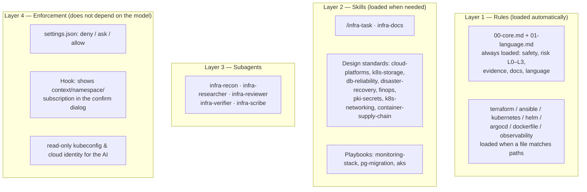

# devops-ai-kit user guide

> Vietnamese version: [../vi/huong-dan.md](../vi/huong-dan.md). This English guide is the main version.

A set of rules and agents for Claude Code, made for DevOps / Cloud work. The kit is designed for this way of working: you SSH into an Ubuntu jump host with VS Code Remote-SSH, and you run Claude Code there.

Terms used in the kit: see the [glossary](glossary.md).

## Contents

0. [What the kit contains](#0-what-the-kit-contains)
1. [Install](#1-install)
1b. [Use it from different places: VS Code Remote-SSH, Desktop app, Windows](#1b-use-it-from-different-places)
2. [Update & uninstall](#2-update--uninstall)
3. [Set up read-only access for the AI (strongly recommended)](#3-set-up-read-only-access-for-the-ai)
4. [Set up each project](#4-set-up-each-project)
5. [Day-to-day use](#5-day-to-day-use)
6. [Full example: migrate PostgreSQL with PGO](#6-example-migrate-postgresql-with-pgo)
7. [Customize](#7-customize)
8. [Limits you should know](#8-limits-you-should-know)
9. [Maintain the rules](#9-maintain-the-rules)
10. [Troubleshooting](#10-troubleshooting)

---

## 0. What the kit contains

The kit has 4 layers. Each layer solves a different problem:



| Layer | Why it is needed |
|---|---|
| Rules | Claude sees only the standards for the technology you are working on. It does not read every standard each time. |
| Skills | Design knowledge and workflows use context only when they are really needed. |
| Subagents | Recon, review and verification run in their own context. The reviewer is a "fresh pair of eyes" and is not affected by how the plan was written. |
| Enforcement | Rules are only instructions; the model can miss them. Permissions, the hook and RBAC are enforced by Claude Code and Kubernetes, whatever the model thinks. |

Kit layout:

```
devops-ai-kit/
├── install.sh · uninstall.sh · check.sh   # install / uninstall / check
├── claude/                                # content installed into ~/.claude/
│   ├── rules/devops-kit/                  # 00-core + 7 technology rules
│   ├── lang/                              # en.md, vi.md → installed as 01-language.md by --lang
│   ├── skills/                            # 16 skills
│   ├── agents/                            # 5 subagents
│   ├── hooks/devops-kit/                  # infra-context-guard.py
│   └── settings.devops-kit.json           # permissions + hook (merged, not overwritten)
├── scripts/                               # kit.py (installer), run-kit.sh, validate.py
├── setup/k8s/                             # read-only RBAC + script that builds the AI kubeconfig
├── templates/                             # sample project CLAUDE.md, PROGRESS.md, extra .gitignore lines
├── tests/                                 # tests for the hook and the installer
└── docs/
    ├── en/                                # guide.md (this file), glossary.md, cloud-readonly.md
    └── vi/                                # huong-dan.md, cloud-readonly.md
```

---

## 1. Install

Do this on the **Ubuntu jump host** (the VS Code terminal after you SSH in). Install once; your work laptop and home laptop both use it, because `~/.claude` lives on the server.

```bash
# 1. Get the kit onto the server
git clone https://github.com/hoangminhung/devops-ai-kit.git ~/devops-ai-kit && cd ~/devops-ai-kit

# 2. Preview what will change (writes nothing)
./install.sh --dry-run

# 3. Install. --lang sets the language of docs and reports: en (default) or vi
./install.sh --lang en

# 4. Check the status + the tools used by verification gates
./check.sh
```

The installer does this:

- **Copies** rules / skills / agents / hook into `~/.claude/`. If an item with the same name exists and it does not belong to the kit, it is **backed up** to `~/.claude/.devops-kit-backup/<timestamp>/` first.
- **Copies the language file** `claude/lang/<lang>.md` to `~/.claude/rules/devops-kit/01-language.md`.
- **Merges** (does not overwrite) permission rules and the hook into `~/.claude/settings.json`, and backs up the old file first. Your own settings (model, other hooks, other rules) stay as they are.
- Writes a manifest `~/.claude/.devops-kit-manifest.json` (with the chosen `lang`), so an update or uninstall touches only what the kit added.

**What `--lang` changes:**

| | `--lang en` (default) | `--lang vi` |
|---|---|---|
| Concept note, runbook, change record, postmortem, ADR | English | Vietnamese (technical terms stay in English) |
| Agent reports | English | Vietnamese |
| README, PR description, commit message, code comments | English | English |
| Chat replies | The language you write in | The language you write in |

Template headings always stay in English, because agents find the parts they need by heading name. A project's CLAUDE.md can override the language.

**After install:** close every running `claude` session, start a new one, then check:

| Command in a Claude session | Expected |
|---|---|
| `/context` | Memory files include `rules/devops-kit/00-core.md` and `01-language.md` |
| `/skills` | `infra-task`, `infra-docs`, `playbook-*`… are listed |
| `/agents` | 5 `infra-*` agents are listed |
| `/permissions` | The kit's deny / ask / allow rules are listed |
| `/hooks` | PreToolUse → `Bash\|PowerShell` → `infra-context-guard.py` |

In the **Claude Desktop app**, some dialog commands (e.g. `/permissions`) say "isn't available in this environment". Then check with `./check.sh` in a terminal, type `/` to see if `infra-task` is in the command list, or ask Claude "list the devops-kit rules that are loaded".

`./check.sh` shows the current language (`Output language`) and lists the tools that are missing for verification gates (tflint, trivy, kubeconform, promtool…). If a tool is missing, Claude reports "gate could not run" instead of skipping it silently. Install the tools you need over time.

---

## 1b. Use it from different places

### Rule: the kit belongs to the machine that runs Claude Code, not to your account

Claude Code reads rules / skills / agents / hooks / `settings.json` from the `~/.claude` folder **of the machine that runs the Claude Code engine**. The account you log in with, or the interface you use, does not matter. So the right question is "which machine runs this session?":

| Interface | Where the engine runs | Reads the kit from |
|---|---|---|
| VS Code extension over Remote-SSH | Ubuntu server | `/home/<user>/.claude/` |
| Desktop app, **SSH** environment | Ubuntu server | `/home/<user>/.claude/` (same place as VS Code) |
| Desktop app, **Local** environment | Windows machine | `C:\Users\<user>\.claude\` |
| Desktop app, **WSL** environment | WSL on the Windows machine | `~/.claude` inside the WSL distro |
| Desktop app, **Cloud** environment | Anthropic's infrastructure | Does not use your `~/.claude`; the kit does not apply |

### Recommended: run every session on the Ubuntu server

The Desktop app has an **SSH** environment: the interface is on Windows, but Claude Code runs on the server. With this setup:

- you install the kit **once**, on the server;
- both interfaces share the read-only kubeconfig, tools, repos and task folders (`/infra-task resume` works across VS Code and Desktop);
- infrastructure credentials do not need to be on the Windows laptop.

Setup:

1. Install the kit on the server as in section 1 (use the VS Code terminal; the Desktop app's built-in terminal exists only in Local sessions).
2. Desktop app → **Code** tab → **Environment** dropdown → **+ Add SSH connection**:
   - **SSH Host:** use the same alias that VS Code Remote-SSH uses in `C:\Users\<user>\.ssh\config`, or `user@host`.
   - **Identity File:** leave empty if it is already set in the ssh config.
3. Pick the new connection, pick the project folder **on the server**, start the session. On the first connection, Desktop installs a copy of Claude Code on the server.
4. Check: type `/` and look for `infra-task`; ask Claude to run `kubectl config current-context` and expect a `-ro` context if you set up section 3.

Notes:

- The kit's hook is registered in `~/.claude/settings.json`, so it runs in Desktop SSH sessions. (Hooks from *plugins* were reported not to run in this mode; the kit does not use plugins.)
- The Claude Code copy installed by Desktop and the one shipped with the VS Code extension can be different versions. Rules / skills are not affected.
- Do not let two sessions (VS Code and Desktop) edit the same repo at the same time. If you need to, use the Desktop **worktree** option.

### When you need the Desktop app in Local mode on Windows

For example, when the repo is on the laptop itself. Install the kit one more time on Windows:

```powershell
# PowerShell
winget install Python.Python.3.12          # if Python is missing; reopen PowerShell after install
git clone https://github.com/hoangminhung/devops-ai-kit.git $HOME\devops-ai-kit
cd $HOME\devops-ai-kit
py -3 scripts\kit.py install --dry-run
py -3 scripts\kit.py install
py -3 scripts\kit.py check
```

(In Git Bash you can use `./install.sh` like on Linux.)

Windows notes:

- **Shell tool:** Claude Code on Windows runs commands through Git Bash (the `Bash` tool) or PowerShell (the `PowerShell` tool).
  - The kit's permission rules are written for `Bash(...)`, so they do **not** apply to commands run with the PowerShell tool.
  - The kit's hook catches both tools, so mutating commands still ask for confirmation with the target shown.
- **Safety rule:** do not keep credentials that can write to production clusters / cloud on the Windows laptop. Do real infrastructure work in sessions that run on the server.
- **Keep both installs in sync.** Clone the same repo on both machines. For each update:

  ```bash
  git pull && ./install.sh        # Ubuntu
  ```

  ```powershell
  git pull; py -3 scripts\kit.py install    # Windows
  ```

---

## 2. Update & uninstall

```bash
cd ~/devops-ai-kit
git pull                # get the new version (or edit the kit content), then:
./install.sh            # update: remove the old kit files, install the new ones, keep the earlier --lang and env
./install.sh --lang vi  # change the output language
./uninstall.sh          # remove all kit files + every line the kit added to settings.json
```

On uninstall: if you did not edit `settings.json` after install, the file goes back **byte for byte** to how it was before. If you did edit it, the kit removes only its own lines and keeps your changes. Empty folders the kit created are removed too.

**Golden rule:** edit inside the kit folder and run `./install.sh`. **Do not edit inside `~/.claude/` directly** (the next install overwrites it). For your own rules that are not part of the kit, use another place, e.g. `~/.claude/rules/personal/`.

---

## 3. Set up read-only access for the AI

This is the **real** protection. Permission rules and the hook match command text, so they can be bypassed (scripts, environment variables, other ways to write a command). Kubernetes RBAC cannot.

Goal:

- **Production** contexts: the AI can only read (and cannot read Secrets).
- **Dev** contexts: the AI can make changes after you confirm.

### 3.1. Kubernetes

Run this from a **normal** terminal (not inside Claude), with your admin access:

```bash
cd ~/devops-ai-kit/setup/k8s
./make-ai-kubeconfig.sh --apply-rbac \
    --readonly aks-prod-weu \
    --readonly onprem-prod \
    --passthrough kind-dev \
    --duration 12h
```

The script will:

- apply `ai-readonly-rbac.yaml` (namespace `ai-access`, ServiceAccount `claude-readonly`, roles `view` + `ai-cluster-reader`) to each `--readonly` cluster;
- create a short-lived token;
- write `~/.kube/ai-config` with the contexts `aks-prod-weu-ro`, `onprem-prod-ro` and `kind-dev` (with your own access);
- check itself: expected `list pods: yes`, `get secrets: no`, `create deployments: no`.

Point Claude Code to this kubeconfig:

```bash
cd ~/devops-ai-kit && ./install.sh --env KUBECONFIG=~/.kube/ai-config
```

From now on every Claude session uses `ai-config`; your normal terminal still uses `~/.kube/config`.

**Token expiry** (default 24h): run `~/.kube/ai-config.refresh.sh` again at the start of the work day. You can add a cron job (e.g. `0 */11 * * * ~/.kube/ai-config.refresh.sh >/dev/null 2>&1`), **but only if** your admin kubeconfig does not need an interactive login. AKS with Entra ID through kubelogin often needs a new login; in that case run it by hand.

**Add API groups:** if a cluster runs other operators (e.g. Strimzi, Istio), add their API groups to `ai-cluster-reader` in `ai-readonly-rbac.yaml`. Never add the core group `""` with `resources: ["*"]`, because that allows reading Secrets.

### 3.2. Cloud

See [cloud-readonly.md](cloud-readonly.md). Summary:

- Azure: a service principal / managed identity with the Reader role, logged in to `~/.azure-ai`, then `./install.sh --env AZURE_CONFIG_DIR=~/.azure-ai`.
- AWS: a `ViewOnlyAccess` profile, then `--env AWS_PROFILE=ai-readonly`.
- GCP: a separate config folder, then `--env CLOUDSDK_CONFIG=...`.

### 3.3. Hard-block every production change (optional)

Add `--env DEVOPS_KIT_BLOCK_PROD=1`. The hook will **deny** (instead of ask) every mutating command whose target name (context, namespace, kubeconfig file name, workspace, …) matches the production pattern (`prod`, `prd`, `production`, `live`). Claude is told to prepare a GitOps PR or give you the command to run yourself. Change the pattern with `--env DEVOPS_KIT_PROD_PATTERN='<regex>'`.

---

## 4. Set up each project

Run these two skills once per repo, in a Claude Code session opened in the repo:

```
/infra-scout                       # reads the repo, writes a short CLAUDE.md (asks before writing)
/infra-rulebook                    # makes the kit's rules load for every infrastructure file
```

**`/infra-scout`** reads Terraform (env folders, backends, workspaces, versions), Helm charts, Argo CD Applications, Ansible inventories, manifests and CI, and drafts the project's `CLAUDE.md` from `templates/project-CLAUDE.md`:

- every value is marked ✅ (found in the repo or cluster) or ⚠️ (inferred); Claude asks you to confirm the ⚠️ ones in short rounds;
- with `--recon <context>` it can also ask the read-only `infra-recon` agent to check the live cluster (it asks you first);
- if the repo already has a CLAUDE.md, it only adds what is missing and shows you a diff; it never removes your text without asking;
- it offers to create `PROGRESS.md` too.

The most important part of `CLAUDE.md` is the **Environment registry** table: which env ↔ which context ↔ which subscription ↔ who may change it. The core rule makes Claude check this table before it touches infrastructure.

**`/infra-rulebook`** fixes repos with a different folder layout. The kit's rules load only for files that match their `paths` (e.g. `**/k8s/**`), so manifests in `deploy/` or Argo CD apps in `apps/*/app.yaml` get no standards. The skill:

1. finds infrastructure files **by content** and shows which ones are covered;
2. proposes narrow globs for the rest and asks you;
3. writes small `.claude/rules/devops-kit-paths-<tech>.md` files with only `paths` and a line that points to the kit rule, for example:

```markdown
---
paths:
  - "deploy/**/*.{yaml,yml}"
---

# devops-ai-kit: Kubernetes files in this repo

The files that match these paths are Kubernetes files. Before you edit them, read `~/.claude/rules/devops-kit/kubernetes.md` and follow it.
```

The standards are never copied into the repo: the kit stays the only source. (An `@import` of the kit file does not work here: Claude Code does not load imports of files outside the project.) Commit these files so the whole team gets them.

To do it by hand instead: copy `templates/project-CLAUDE.md` and `templates/PROGRESS.md` into the repo and fill them in, and add `templates/gitignore-additions.txt` to `.gitignore`.

Do not use `claude init` to generate a long CLAUDE.md and keep it as is: keep only the project-specific parts, so the context loaded in each session stays small.

---

## 5. Day-to-day use

### 5.1. L0 / L1 work: just work as usual

Prompt in a normal way, for example: "find out why pod loki-0 keeps restarting", "write a terraform module that creates a storage account for the dev environment".

You will see these differences:

- Claude states the **context / namespace / subscription** before it touches infrastructure.
- Before a mutating command, Claude writes 4 lines: **What · Target · Reversible? · Undo**.
- The Claude Code confirm dialog shows a line from the hook, for example:
  `devops-ai-kit: ⚠️ PRODUCTION · helm upgrade loki → context=aks-prod-weu namespace=monitoring`
  This is where you catch a "wrong cluster" mistake before it is too late.
  If the kubeconfig in use is not the default one, the line also shows its file name (`kubeconfig=kubeconfig.hetzner-live`). This helps when every cluster's context is just called `default`.
- When you edit a `.tf` file, the Terraform standards load; when you edit Helm values, the Helm standards load…
- A "done" report always includes commands and output as proof.

If Claude decides the work is L2 / L3, it stops and asks you to run `/infra-task`.

### 5.2. L2 / L3 work: `/infra-task`

```
/infra-task Deploy Loki + Alloy to replace Promtail on cluster aks-stg-weu, storage on Longhorn, retention 14 days
```

Claude goes through these phases; each phase leaves a file in `docs/changes/<date>-<slug>/`:

| Phase | Who | File | What you do |
|---|---|---|---|
| 0. Brief | Main session | `00-brief.md` | Confirm the scope + risk level |
| 1. Recon | `infra-recon` | `01-recon.md` | Read "Key findings" for surprises |
| 2. Research | `infra-researcher` | `02-research.md` | Check breaking changes and open questions |
| 3. Plan | Main session | `03-plan.md` | Give feedback; you can edit the file |
| 4. Plan review | `infra-reviewer` | `04-plan-review.md` | **GATE 1:** approve the plan |
| 5. Implement | Main session | `05-implementation.md` | Check the diff + gate results |
| 6. Code review | `infra-reviewer` | `06-code-review.md` | **GATE 2:** approve the change |
| 7. Execute | Main session | `07-execution-log.md` | Confirm each command; run / merge the PR yourself for production steps |
| 8. Verify | `infra-verifier` | `08-verification.md` | Check PASS / FAIL |
| 9. Docs | `infra-scribe` | `09-change-record.md` + runbook / concept / ADR | Read, fix if needed, commit |

**Stop halfway and change machine:** everything is in files on the server, so from your home laptop open a new session and type:

```
/infra-task resume docs/changes/2026-10-28-loki-alloy
```

**How resume works.** Each step in `03-plan.md` is a checkbox: `- [ ] Step 3: …`. In phase 7 Claude ticks a step only after its verify passes (`- [x] Step 3: … — ✅ <time> UTC · <result>`). On resume, Claude:

1. finds the first unticked step (`scripts/plan_status.py status`);
2. **checks the live state first**: it runs the verify command of the last ticked step (read-only, plus a quick `infra-recon` for L2/L3), because someone may have changed the system in between;
3. stops and asks you if anything differs; otherwise it continues from that step.

Old plans without checkboxes still work: Claude reads `07-execution-log.md` and offers to convert the plan.

**You change the request halfway.** Tell Claude the change. It stops before the next command and:

- writes the change in `00-brief.md`;
- edits **only steps that have not run yet** (ticked steps stay as history; new steps get a letter, e.g. `Step 3b`; nothing is renumbered);
- asks `infra-reviewer` to review only the changed steps;
- adds a row to "Changes during execution" in the plan;
- waits for your OK before it runs anything.

**Missing information at the start.** If the brief has no clear target environment, success criteria, allowed downtime, scope or rollback expectation, Claude runs a short `grill-me` interview in phase 0 before planning.

**Run mode: `--mode auto | interactive`.**

```
/infra-task --mode auto Upgrade Grafana 11.x → 12.x on aks-stg-weu
```

- `interactive` (default): Claude stops after each phase and waits for you.
- `auto`: Claude runs the paper phases without stopping (recon → research → plan → plan review, then implement → code review, then verify → docs) and asks only when it cannot decide from facts.
- **Both modes stop at GATE 1, GATE 2 and before every mutating command.** The mode only changes the phases that do not touch the system.
- **L3 is always interactive.** `auto` is only for L1 / L2, and only when you ask for it. The mode is saved in `00-brief.md`, so `resume` keeps it.

**Big tasks: slices.** For an L3 task with several independent parts, or a plan with more than ~10 steps, Claude suggests cutting it into slices, e.g. monitoring: 01 metrics → 02 logs (Alloy + Loki) → 03 alert routing.

- Each slice is deployed, verified and rolled back on its own, with its own plan, GATE 1, GATE 2 and verify, in `slices/<NN>-<name>/` inside the task folder.
- If a slice fails, Claude stops there; the next slices do not start, and earlier slices stay as they are.
- One change record covers the whole task. Details: `references/slicing.md` of the `infra-task` skill.

### 5.3. Write documentation

The `infra-docs` skill starts by itself when you ask for docs. Example prompts:

- "Write a concept note about Longhorn for new team members, based on cluster aks-stg-weu"
- "Write a runbook for Loki in namespace monitoring"
- "Write an ADR for the decision to use Alloy instead of Promtail"
- "Write a postmortem for this morning's full Prometheus PVC incident"

The language of the docs follows `--lang` from install time (see section 1).

Every doc marks information as ✅ (checked with a command) · 📖 (from the docs, with link) · ⚠️ (guess). When you read it later, you know right away which parts to check yourself.

### 5.4. Learn a new tool / tech stack

1. Ask for research first: "use infra-researcher to find out how PGO 5.x creates a standby cluster from a pgBackRest repo, with sources".
2. Ask for a concept note from that result, with examples on your own cluster.
3. While you work, if your Claude Code version has output styles, turn on the explanatory style (`/output-style`, choose Explanatory) so Claude adds "why" explanations as it works. Turn it off when you do not need it, to keep answers short.
4. The "Self-check questions" part at the end of a concept note: use it to test yourself, or give it to new people during onboarding.

### 5.5. When Claude lacks context: `/grill-me`

Use it when your request is still vague, or when you feel Claude is guessing. Claude also starts it by itself when important information is missing.

```
/grill-me move the monitoring stack to the new cluster
```

- Claude first checks the facts it can find itself (versions, namespaces, what the repo does) with read-only commands.
- Then it asks you only for **decisions**, in short rounds of 2–4 questions. Each question has a recommended answer, so you can reply "1 yes, 2 option B, 3 not sure".
- At the end it writes a short **Context brief** and asks you to confirm it. The brief goes into the task folder (`/infra-task`) or into `PROGRESS.md`.

Tip: do not just say "agree" to everything. Push back when a recommendation does not fit; that is where the value is.

### 5.6. Memory across sessions

A long session is compacted many times, and each time some details can be lost. Keep what matters in files instead:

| What | Where |
|---|---|
| Stable facts: environments, conventions, **Standing rules** | project `CLAUDE.md` |
| Goals, overall state, open items, decisions, **one line per task with a link** | `PROGRESS.md` |
| All the details of one L2/L3 change (plan, steps, log, verification) | its task folder (`/infra-task`), never copied into `PROGRESS.md` |
| Knowledge that lasts | runbook, concept note, ADR (`infra-docs`) |

- Claude reads `PROGRESS.md` at the start of a session and updates it after each task or important decision.
- When you say "always …", "never …" or "remember …", Claude proposes a line for **Standing rules** in `CLAUDE.md`. You do not need to repeat the rule in every session.
- Prefer one session per topic. Start a new session with: "Read CLAUDE.md and PROGRESS.md, then continue."

---

## 6. Example: migrate PostgreSQL with PGO

```
/infra-task Migrate database orders (PGO, PostgreSQL 16) from cluster onprem-old to onprem-new, max downtime 15 minutes
```

- **Brief:** Claude proposes **L3** (stateful, has a point of no return). You confirm.
- **Recon:**
  - PGO version on both sides;
  - DB size, tables without a primary key;
  - extensions;
  - where the pgBackRest repo is, the latest backup;
  - glibc of the images on both sides;
  - how the app connects.
- **Research:** how to create a standby cluster for the target PGO version; how to promote; known issues.
- **Plan** (following `playbook-pg-migration`):
  - choose a method (e.g. standby from a shared repo);
  - rehearse with a restore first;
  - the target cluster has its own backup + monitoring **before** cutover;
  - cutover steps with write freeze, row count / checksum / sequence checks;
  - the point of no return (PONR) and the rollback decision deadline.
- **Plan review:** the reviewer can catch issues like "no test restore step", "rollback after PONR is not defined", "glibc not checked".
- **Execute:** production steps are usually marked "user" or "GitOps PR". Claude gives the command / PR; you run or merge it and report back; Claude logs it and checks the stop conditions.
- **Verify + Docs:** a data check table, a change record with the real time of each step (very useful for the next migration), a runbook for the new cluster.

---

## 7. Customize

| You want to | Where |
|---|---|
| Change / add standards for a technology | Edit `claude/rules/devops-kit/<tech>.md` or the matching skill, run `./install.sh` |
| Add a playbook for a new task type (e.g. "upgrade a Kubernetes cluster") | Copy a `playbook-*` folder, change `name` / `description` / content, add it to the mapping table in `infra-task/SKILL.md` |
| A rule for one project only | `project/.claude/rules/*.md` (commit it with the repo) |
| Add commands to the deny / ask / allow lists | `claude/settings.devops-kit.json`, then `./install.sh` |
| Change an agent's model | The `model:` field in `claude/agents/*.md` |
| Change the docs language | `./install.sh --lang en\|vi` (global), edit `claude/lang/<lang>.md`, or write it in the project's CLAUDE.md |

**When you add a skill:**

- `description` (English) decides whether the skill starts by itself. Be specific and a bit "pushy" (list the situations where it applies).
- `when_to_use`: an English sentence first, then the Vietnamese phrases people often use (`Vietnamese triggers — "...", "..."`), so the skill still starts when someone prompts in Vietnamese. `description` + `when_to_use` must be 1536 characters or less.
- Keep rules short, because they use context every time they load.
- Write kit content in plain English. Run the checks in section 9 before you commit.

---

## 8. Limits you should know

- **Rules and skills are instructions, not laws.** The model can miss them in a turn; that is why layer 4 exists.
- **Permission rules and the hook match command text**, so they can be bypassed: commands inside scripts, `eval`, environment variables, aliases. The hook does not read commands inside a script file that is called. They are a safety net for honest mistakes, not a security wall. The real wall is the read-only kubeconfig / cloud identity.
- **The hook fails open:** on an internal error it blocks nothing and lets the normal confirm flow decide. The hook does not know the namespace set inside a YAML file (`metadata.namespace`); it shows the namespace from the flag or from the context.
- **Flags before the verb.** Permission rules match text from the start, so the kit adds a twin rule for each `kubectl` / `helm` / `terraform` rule (`kubectl * get *`, `terraform -chdir=* plan*`). The hook parses the flags and denies the forbidden commands (namespace / PVC / CRD deletes, destroy, helm uninstall, secret values) in any order.
- **Some deny patterns are a bit broad.** For example `kubectl * get secret*-o*` also blocks `kubectl --context X get secretstores -o yaml`, and `helm * delete*` blocks a `helm template … --set delete=…`. If a command is blocked by mistake, run it in your own terminal.
- **`make` targets:** the hook asks for targets whose name looks like a change (`apply`, `deploy`, `destroy`, …) and shows the variables, but it cannot see the commands inside the Makefile.
- **Skills start based on their description**, so they do not always trigger. To be sure, call them by name (`/infra-docs`, "use playbook-pg-migration").
- **Playbooks and standards do not replace the official docs.** They list what you must not forget; version-specific details must always be confirmed by the researcher.
- **Subagents cost more tokens and time.** That is why there are levels L0–L3: do not run `/infra-task` for L1 work.

---

## 9. Maintain the rules

- Each file has a `Last reviewed: <date>` line. Review the files **every 3–6 months**: infrastructure tools change fast (Promtail, Grafana Agent and ingress-nginx all reached EOL within about a year).
- After each `/infra-task`, read the improvement ideas in the close-task step. If the AI repeats a mistake, add exactly one line to block it in the right place; do not add a whole paragraph.
- Run `/doctor prompt-audit` in Claude Code from time to time (if your version has it) to find outdated rules, links to missing files, or conflicts. This matters most if you install this kit together with other kits.
- **Automatic checks before you commit** (CI runs the same commands on every pull request to `main`; merge is blocked until they pass):

  ```bash
  python3 scripts/validate.py                       # frontmatter, name, paths, length, referenced files, leftover Vietnamese
  python3 -m unittest discover -s tests -v          # hook and installer tests (use a temp HOME, do not touch ~/.claude)
  shellcheck -S warning *.sh scripts/*.sh setup/k8s/*.sh sandbox/*.sh scenarios/*.sh
  ```

- **Test the kit's behaviour** with the scenarios in `scenarios/` (Contributing / Testing the kit):
  - layer 1, `sandbox/repo/`: a sample infrastructure repo (Terraform with local providers only, Helm, Argo CD manifest, Ansible for localhost); no cloud, no cluster; enough for 6 of the 10 scenarios;
  - layer 2, optional: `sandbox/up.sh` creates a kind cluster with traps (ingress-nginx, a `Delete` StorageClass, a fake Secret, a `sandbox-prod` context and a read-only `-ro` context), using its own kubeconfig, never `~/.kube/config`;
  - `scenarios/prepare.sh <NN>` makes a fresh work copy; `scenarios/run-headless.sh` runs the scenarios that have a check block with `claude -p` (costs tokens, not in CI).
  - Scenarios test the kit **installed** in your Claude config dir: an installed skill wins over a project copy with the same name. To test a branch, install it into a separate `CLAUDE_CONFIG_DIR`.
- Keep the kit in git, with one clear commit per change. To use it on another server or share it with a team, clone it and run `./install.sh`.

---

## 10. Troubleshooting

| Symptom | Check / fix |
|---|---|
| New rules / skills / agents do not show | Close all `claude` sessions, start a new one. Run `./check.sh`. |
| A technology rule does not load when you edit a file | Does the file path match `paths`? If the repo uses other folders, add a project-level rule (section 4). |
| A skill does not start by itself | Call it by name. Add the words you often use to `when_to_use` and install again. |
| Docs are in the wrong language | Run `./check.sh` and look at `Output language`. Change it with `./install.sh --lang en` (or `vi`) and start a new session. Check whether the project's CLAUDE.md overrides it. |
| The hook does not show a `devops-kit:` line | Is it registered in `/hooks`? Is `python3` in PATH? Turn it off for now with `DEVOPS_KIT_GUARD_OFF=1`. |
| `Forbidden` on a `-ro` context | Expected. Run that command in your own terminal, or add read access to `ai-cluster-reader`. |
| `Unauthorized` on a `-ro` context | The token expired: run `~/.kube/ai-config.refresh.sh`. |
| Too many confirm prompts | Add read-only commands to `allow` in `settings.devops-kit.json`. `ask` rules always win over `allow`, so mutating commands are still asked. |
| You want settings back to how they were before install | `./uninstall.sh`; backups are in `~/.claude/.devops-kit-backup/`. |
