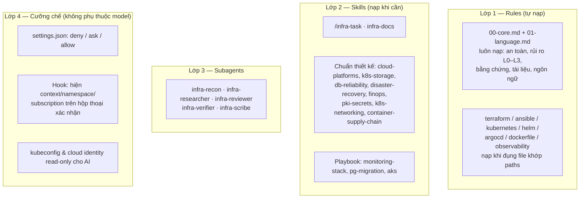

# Hướng dẫn sử dụng devops-ai-kit

> English version (bản chuẩn): [../en/guide.md](../en/guide.md). Bản tiếng Việt có thể cập nhật chậm hơn.

Bộ quy tắc và hệ thống agent cho Claude Code, dành cho công việc DevOps / Cloud. Kit được thiết kế cho mô hình làm việc: SSH vào máy chủ Ubuntu trung gian bằng VS Code Remote-SSH, rồi chạy Claude Code trên đó.

Thuật ngữ dùng trong kit: xem [bảng thuật ngữ](../en/glossary.md) (có cột tiếng Việt).

## Mục lục

0. [Kit gồm những gì](#0-kit-gồm-những-gì)
1. [Cài đặt](#1-cài-đặt)
1b. [Dùng trên nhiều bề mặt: VS Code Remote-SSH, Desktop app, Windows](#1b-dùng-trên-nhiều-bề-mặt)
2. [Cập nhật & gỡ cài](#2-cập-nhật--gỡ-cài)
3. [Thiết lập quyền read-only cho AI (rất nên làm)](#3-thiết-lập-quyền-read-only-cho-ai)
4. [Thiết lập cho từng project](#4-thiết-lập-cho-từng-project)
5. [Dùng hằng ngày](#5-dùng-hằng-ngày)
6. [Ví dụ đi trọn một task: migrate PostgreSQL bằng PGO](#6-ví-dụ-migrate-postgresql-bằng-pgo)
7. [Tùy biến](#7-tùy-biến)
8. [Giới hạn cần biết](#8-giới-hạn-cần-biết)
9. [Bảo trì bộ quy tắc](#9-bảo-trì-bộ-quy-tắc)
10. [Xử lý sự cố](#10-xử-lý-sự-cố)

---

## 0. Kit gồm những gì

Kit có 4 lớp. Mỗi lớp giải quyết một vấn đề khác nhau:



| Lớp | Vì sao cần |
|---|---|
| Rules | Claude chỉ thấy đúng chuẩn của công nghệ đang làm, không phải đọc mọi chuẩn mỗi lần. |
| Skills | Kiến thức thiết kế và quy trình chỉ tốn context khi thật sự cần. |
| Subagents | Tách việc khảo sát, phản biện và kiểm chứng ra context riêng. Reviewer là "đôi mắt mới", không bị ảnh hưởng bởi quá trình viết plan. |
| Cưỡng chế | Rules chỉ là lời dặn, model có thể bỏ qua. Permission, hook và RBAC thì Claude Code và Kubernetes cưỡng chế, bất kể model nghĩ gì. |

Cấu trúc thư mục của kit:

```
devops-ai-kit/
├── install.sh · uninstall.sh · check.sh   # cài / gỡ / kiểm tra
├── claude/                                # nội dung được cài vào ~/.claude/
│   ├── rules/devops-kit/                  # 00-core + 7 rule theo công nghệ
│   ├── lang/                              # en.md, vi.md → cài thành 01-language.md theo --lang
│   ├── skills/                            # 13 skill
│   ├── agents/                            # 5 subagent
│   ├── hooks/devops-kit/                  # infra-context-guard.py
│   └── settings.devops-kit.json           # permission + hook (được merge, không ghi đè)
├── scripts/                               # kit.py (bộ cài), run-kit.sh, validate.py
├── setup/k8s/                             # RBAC read-only + script tạo kubeconfig cho AI
├── templates/                             # CLAUDE.md mẫu cho project, .gitignore bổ sung
├── tests/                                 # test cho hook và bộ cài
└── docs/
    ├── en/                                # guide.md, glossary.md, cloud-readonly.md (bản chuẩn)
    └── vi/                                # huong-dan.md (file này), cloud-readonly.md
```

---

## 1. Cài đặt

Làm trên **máy chủ Ubuntu trung gian** (terminal của VS Code sau khi SSH vào). Cài một lần, cả máy công ty lẫn máy nhà đều dùng chung, vì `~/.claude` nằm trên máy chủ.

```bash
# 1. Lấy kit về server
git clone https://github.com/hoangminhung/devops-ai-kit.git ~/devops-ai-kit && cd ~/devops-ai-kit

# 2. Xem trước những gì sẽ thay đổi (không ghi gì cả)
./install.sh --dry-run --lang vi

# 3. Cài. --lang chọn ngôn ngữ cho tài liệu và báo cáo: en (mặc định) hoặc vi
./install.sh --lang vi

# 4. Kiểm tra trạng thái + công cụ cho verification gate
./check.sh
```

Bộ cài làm những việc sau:

- **Copy** rules / skills / agents / hook vào `~/.claude/`. Item nào trùng tên mà không phải của kit thì được **backup** vào `~/.claude/.devops-kit-backup/<thời-điểm>/` trước khi thay.
- **Copy file ngôn ngữ** `claude/lang/<lang>.md` thành `~/.claude/rules/devops-kit/01-language.md`.
- **Merge** (không ghi đè) permission rules và hook vào `~/.claude/settings.json`; backup file cũ trước khi ghi. Cấu hình sẵn có của bạn (model, hook khác, rule khác) được giữ nguyên.
- Ghi manifest `~/.claude/.devops-kit-manifest.json` (kèm `lang` đã chọn), để lần cập nhật hoặc gỡ cài chỉ đụng tới đúng những gì kit đã thêm.

**`--lang` khác nhau thế nào:**

| | `--lang en` (mặc định) | `--lang vi` |
|---|---|---|
| Concept note, runbook, change record, postmortem, ADR | Tiếng Anh | Tiếng Việt (thuật ngữ kỹ thuật giữ tiếng Anh) |
| Báo cáo của agents | Tiếng Anh | Tiếng Việt |
| README, PR description, commit message, code comment | Tiếng Anh | Tiếng Anh |
| Trả lời trong chat | Theo ngôn ngữ bạn đang dùng | Theo ngôn ngữ bạn đang dùng |

Tiêu đề mục trong template luôn giữ tiếng Anh, vì các agent tìm phần cần đọc theo tên tiêu đề. CLAUDE.md của project có thể ghi đè ngôn ngữ.

**Sau khi cài:** đóng mọi phiên `claude` đang chạy, mở phiên mới, rồi kiểm tra:

| Lệnh trong phiên Claude | Kỳ vọng |
|---|---|
| `/context` | Mục Memory files có `rules/devops-kit/00-core.md` và `01-language.md` |
| `/skills` | Có `infra-task`, `infra-docs`, `playbook-*`… |
| `/agents` | Có 5 agent `infra-*` |
| `/permissions` | Có các rule deny / ask / allow của kit |
| `/hooks` | Có PreToolUse → `Bash\|PowerShell` → `infra-context-guard.py` |

Trong **Claude Desktop app**, một số lệnh dạng hộp thoại (ví dụ `/permissions`) báo "isn't available in this environment". Khi đó kiểm tra bằng `./check.sh` trong terminal, gõ `/` để xem `infra-task` có trong danh sách lệnh, hoặc hỏi Claude "liệt kê các rule devops-kit đang được nạp".

`./check.sh` hiện ngôn ngữ đang dùng (`Output language`) và liệt kê công cụ còn thiếu cho các verification gate (tflint, trivy, kubeconform, promtool…). Thiếu công cụ nào thì Claude sẽ báo "gate chưa chạy được" thay vì bỏ qua im lặng. Cài dần những công cụ bạn cần.

---

## 1b. Dùng trên nhiều bề mặt

### Nguyên tắc: kit gắn với máy chạy Claude Code, không gắn với tài khoản

Claude Code đọc rules / skills / agents / hooks / `settings.json` từ thư mục `~/.claude` **của máy đang chạy engine Claude Code**. Bạn đăng nhập tài khoản nào, hay dùng giao diện nào, không quan trọng. Vì vậy câu hỏi đúng là "phiên này chạy trên máy nào?":

| Bề mặt | Engine chạy ở đâu | Đọc kit từ |
|---|---|---|
| VS Code extension qua Remote-SSH | Máy chủ Ubuntu | `/home/<user>/.claude/` |
| Desktop app, environment **SSH** | Máy chủ Ubuntu | `/home/<user>/.claude/` (cùng chỗ với VS Code) |
| Desktop app, environment **Local** | Máy Windows | `C:\Users\<user>\.claude\` |
| Desktop app, environment **WSL** | WSL trên máy Windows | `~/.claude` bên trong distro WSL |
| Desktop app, environment **Cloud** | Hạ tầng của Anthropic | Không dùng `~/.claude` của bạn; kit không áp dụng |

### Cách khuyến nghị: mọi phiên đều chạy trên máy chủ Ubuntu

Desktop app có environment **SSH**: giao diện ở Windows, nhưng Claude Code chạy trên máy chủ. Dùng cách này thì:

- chỉ cài kit **một lần** trên máy chủ;
- cả hai giao diện dùng chung kubeconfig read-only, công cụ, repo và thư mục task (`/infra-task resume` được chéo giữa VS Code và Desktop);
- credential hạ tầng không cần nằm trên laptop Windows.

Thiết lập:

1. Cài kit trên máy chủ như mục 1 (dùng terminal của VS Code; terminal tích hợp của Desktop app chỉ có ở phiên Local).
2. Desktop app → tab **Code** → dropdown **Environment** → **+ Add SSH connection**:
   - **SSH Host:** dùng đúng alias mà VS Code Remote-SSH đang dùng trong `C:\Users\<user>\.ssh\config`, hoặc `user@host`.
   - **Identity File:** để trống nếu đã khai báo trong ssh config.
3. Chọn connection vừa tạo, chọn thư mục project **trên máy chủ**, bắt đầu phiên. Lần kết nối đầu, Desktop tự cài một bản Claude Code lên máy chủ.
4. Kiểm tra: gõ `/` xem có `infra-task`; nhờ Claude chạy `kubectl config current-context`, kỳ vọng ra context `-ro` nếu đã cấu hình mục 3.

Lưu ý:

- Hook của kit đăng ký trong `~/.claude/settings.json` nên chạy được trong phiên SSH của Desktop. (Hook do *plugin* cung cấp từng được báo cáo là không chạy trong chế độ này; kit không dùng plugin.)
- Bản Claude Code do Desktop cài và bản đi kèm VS Code extension có thể khác version. Rules / skills không bị ảnh hưởng.
- Tránh để hai phiên (VS Code và Desktop) cùng sửa một repo cùng lúc. Nếu cần, dùng tùy chọn **worktree** của Desktop.

### Khi cần dùng Desktop app ở chế độ Local trên Windows

Ví dụ khi bạn làm việc với repo nằm trên chính laptop. Cài kit thêm một lần trên Windows:

```powershell
# PowerShell
winget install Python.Python.3.12          # nếu chưa có Python; mở lại PowerShell sau khi cài
git clone https://github.com/hoangminhung/devops-ai-kit.git $HOME\devops-ai-kit
cd $HOME\devops-ai-kit
py -3 scripts\kit.py install --dry-run --lang vi
py -3 scripts\kit.py install --lang vi
py -3 scripts\kit.py check
```

(Trong Git Bash có thể dùng `./install.sh` như trên Linux.)

Lưu ý riêng cho Windows:

- **Shell tool:** Claude Code trên Windows chạy lệnh qua Git Bash (tool `Bash`) hoặc PowerShell (tool `PowerShell`).
  - Permission rules của kit viết cho `Bash(...)`, nên **không** áp lên lệnh chạy bằng tool PowerShell.
  - Hook của kit bắt cả hai tool, nên lệnh mutating vẫn bị hỏi kèm thông tin đích.
- **Quy tắc an toàn:** không để credential có quyền ghi vào cluster / cloud production trên laptop Windows. Làm việc hạ tầng thật qua phiên chạy trên máy chủ.
- **Hai bản cài phải đồng bộ.** Clone cùng một repo về cả hai máy. Mỗi lần cập nhật:

  ```bash
  git pull && ./install.sh        # Ubuntu
  ```

  ```powershell
  git pull; py -3 scripts\kit.py install    # Windows
  ```

---

## 2. Cập nhật & gỡ cài

```bash
cd ~/devops-ai-kit
git pull                # lấy bản mới (hoặc sửa nội dung kit), rồi:
./install.sh            # cập nhật: gỡ bản cũ của kit, cài bản mới, giữ nguyên --lang và env đã đặt trước đó
./install.sh --lang en  # đổi ngôn ngữ đầu ra
./uninstall.sh          # gỡ toàn bộ file + mọi dòng kit đã thêm vào settings.json
```

Khi gỡ cài: nếu bạn không sửa `settings.json` sau khi cài, file được trả về **đúng từng byte** như trước khi cài. Nếu bạn đã sửa, kit chỉ xóa những dòng của kit và giữ phần bạn sửa. Thư mục rỗng do kit tạo cũng được xóa.

**Quy tắc vàng:** sửa trong thư mục kit rồi chạy `./install.sh`, **không sửa trực tiếp trong `~/.claude/`** (lần cài sau sẽ ghi đè). Muốn thêm quy tắc riêng không thuộc kit thì đặt ở chỗ khác, ví dụ `~/.claude/rules/personal/`.

---

## 3. Thiết lập quyền read-only cho AI

Đây là lớp bảo vệ **thật sự**. Permission rules và hook so khớp theo chuỗi lệnh nên vẫn có thể bị lách (script, biến môi trường, cách viết lệnh khác), còn RBAC của Kubernetes thì không.

Mục tiêu:

- Context **production**: AI chỉ đọc (không đọc được Secret).
- Context **dev**: AI được thay đổi sau khi bạn xác nhận.

### 3.1. Kubernetes

Chạy từ terminal **bình thường** (không phải trong Claude), bằng quyền admin của bạn:

```bash
cd ~/devops-ai-kit/setup/k8s
./make-ai-kubeconfig.sh --apply-rbac \
    --readonly aks-prod-weu \
    --readonly onprem-prod \
    --passthrough kind-dev \
    --duration 12h
```

Script sẽ:

- áp `ai-readonly-rbac.yaml` (namespace `ai-access`, ServiceAccount `claude-readonly`, role `view` + `ai-cluster-reader`) vào từng cluster `--readonly`;
- tạo token ngắn hạn;
- ghi `~/.kube/ai-config` với các context `aks-prod-weu-ro`, `onprem-prod-ro` và `kind-dev` (giữ nguyên quyền của bạn);
- tự kiểm tra: kỳ vọng `list pods: yes`, `get secrets: no`, `create deployments: no`.

Trỏ Claude Code tới kubeconfig này:

```bash
cd ~/devops-ai-kit && ./install.sh --env KUBECONFIG=~/.kube/ai-config
```

Từ giờ mọi phiên Claude dùng `ai-config`; terminal thường của bạn vẫn dùng `~/.kube/config` như cũ.

**Token hết hạn** (mặc định 24h): chạy lại `~/.kube/ai-config.refresh.sh` đầu ngày làm việc. Có thể đặt cron (ví dụ `0 */11 * * * ~/.kube/ai-config.refresh.sh >/dev/null 2>&1`), **nhưng chỉ khi** kubeconfig admin của bạn không cần đăng nhập tương tác. AKS dùng Entra ID qua kubelogin thường cần đăng nhập lại, khi đó hãy chạy tay.

**Thêm API group:** cluster chạy operator khác (ví dụ Strimzi, Istio) thì thêm API group của nó vào `ai-cluster-reader` trong `ai-readonly-rbac.yaml`. Không thêm group lõi `""` với `resources: ["*"]`, vì như vậy là cho đọc Secret.

### 3.2. Cloud

Xem [cloud-readonly.md](cloud-readonly.md). Tóm tắt:

- Azure: service principal / managed identity có role Reader, đăng nhập vào `~/.azure-ai`, rồi `./install.sh --env AZURE_CONFIG_DIR=~/.azure-ai`.
- AWS: profile `ViewOnlyAccess`, rồi `--env AWS_PROFILE=ai-readonly`.
- GCP: thư mục cấu hình riêng, rồi `--env CLOUDSDK_CONFIG=...`.

### 3.3. Chặn cứng mọi thay đổi production (tùy chọn)

Đặt thêm `--env DEVOPS_KIT_BLOCK_PROD=1`. Hook sẽ **từ chối** (thay vì hỏi) mọi lệnh mutating mà đích có tên khớp mẫu production (`prod`, `prd`, `production`, `live`). Claude sẽ được báo là phải chuẩn bị PR GitOps hoặc đưa lệnh cho bạn tự chạy. Đổi mẫu nhận diện bằng `--env DEVOPS_KIT_PROD_PATTERN='<regex>'`.

---

## 4. Thiết lập cho từng project

```bash
cd ~/projects/project-A
cp ~/devops-ai-kit/templates/project-CLAUDE.md ./CLAUDE.md        # rồi điền
cat ~/devops-ai-kit/templates/gitignore-additions.txt >> .gitignore
```

Quan trọng nhất trong `CLAUDE.md` của project là bảng **Environment registry**: env nào ↔ context nào ↔ subscription nào ↔ ai được thay đổi. Rule cốt lõi bắt Claude đối chiếu bảng này trước khi chạm hạ tầng.

Không dùng `claude init` để sinh CLAUDE.md dài rồi giữ nguyên. Nếu đã có CLAUDE.md, giữ phần riêng của project và xóa những gì đã có trong kit (nguyên tắc an toàn, chuẩn Terraform…), để tổng context nạp mỗi phiên luôn gọn.

**Repo có cấu trúc thư mục khác** (ví dụ manifest nằm ở `deploy/`): rule `kubernetes.md` của kit sẽ không tự nạp. Tạo rule cấp project để bổ sung paths:

```markdown
<!-- project-A/.claude/rules/k8s-paths.md -->
---
paths:
  - "deploy/**/*.yaml"
---
Files in deploy/ are Kubernetes manifests: apply the standards in ~/.claude/rules/devops-kit/kubernetes.md (read that file before editing).
```

---

## 5. Dùng hằng ngày

### 5.1. Việc L0 / L1: cứ làm như bình thường

Chỉ cần prompt tự nhiên, ví dụ: "xem giúp vì sao pod loki-0 restart liên tục", "viết module terraform tạo storage account cho môi trường dev".

Bạn sẽ thấy các khác biệt so với trước:

- Claude nêu rõ **context / namespace / subscription** trước khi chạm hạ tầng.
- Trước lệnh mutating, Claude viết 4 dòng: **What · Target · Reversible? · Undo** (Làm gì · Tác động lên · Đảo ngược được? · Hoàn tác).
- Hộp thoại xác nhận của Claude Code có dòng của hook, ví dụ:
  `devops-ai-kit: ⚠️ PRODUCTION · helm upgrade loki → context=aks-prod-weu namespace=monitoring`
  Đây là chỗ để bạn bắt lỗi "nhầm cluster" trước khi quá muộn.
- Sửa file `.tf` thì chuẩn Terraform tự nạp; sửa values Helm thì chuẩn Helm tự nạp…
- Báo cáo "xong" luôn kèm lệnh và output làm bằng chứng.

Nếu Claude đánh giá việc là L2 / L3, nó sẽ dừng và đề nghị bạn chạy `/infra-task`.

### 5.2. Việc L2 / L3: `/infra-task`

```
/infra-task Triển khai Loki + Alloy thay Promtail trên cluster aks-stg-weu, lưu trữ trên Longhorn, retention 14 ngày
```

Claude đi qua các pha sau; mỗi pha để lại một file trong `docs/changes/<ngày>-<slug>/`:

| Pha | Ai làm | File | Bạn cần làm gì |
|---|---|---|---|
| 0. Brief | Phiên chính | `00-brief.md` | Xác nhận phạm vi + cấp rủi ro |
| 1. Recon | `infra-recon` | `01-recon.md` | Đọc mục "Key findings" xem có gì bất ngờ |
| 2. Research | `infra-researcher` | `02-research.md` | Xem breaking changes, câu hỏi chưa xác nhận được |
| 3. Plan | Phiên chính | `03-plan.md` | Góp ý trực tiếp, có thể sửa file |
| 4. Plan review | `infra-reviewer` | `04-plan-review.md` | **GATE 1:** duyệt plan |
| 5. Implement | Phiên chính | `05-implementation.md` | Xem diff + kết quả gate |
| 6. Code review | `infra-reviewer` | `06-code-review.md` | **GATE 2:** duyệt thay đổi |
| 7. Execute | Phiên chính | `07-execution-log.md` | Xác nhận từng lệnh; tự chạy / merge PR với bước production |
| 8. Verify | `infra-verifier` | `08-verification.md` | Xem PASS / FAIL |
| 9. Docs | `infra-scribe` | `09-change-record.md` + runbook / concept / ADR | Đọc lại, sửa nếu cần, commit |

**Làm dở, chuyển máy:** vì mọi thứ nằm trong file trên server, từ máy nhà mở phiên mới và gõ:

```
/infra-task resume docs/changes/2026-10-28-loki-alloy
```

### 5.3. Viết tài liệu

Skill `infra-docs` tự kích hoạt khi bạn nhờ viết tài liệu. Ví dụ prompt:

- "Viết concept note về Longhorn cho người mới vào team, dựa trên cluster aks-stg-weu"
- "Viết runbook cho Loki trong namespace monitoring"
- "Viết ADR cho quyết định dùng Alloy thay Promtail"
- "Viết postmortem cho sự cố PVC Prometheus đầy sáng nay"

Ngôn ngữ của tài liệu theo `--lang` lúc cài (xem mục 1).

Mọi tài liệu đánh dấu ✅ (đã kiểm chứng bằng lệnh) · 📖 (theo tài liệu, kèm link) · ⚠️ (suy luận). Khi đọc lại, bạn biết ngay phần nào cần tự kiểm tra.

### 5.4. Học công cụ / tech stack mới

1. Nhờ research trước: "dùng infra-researcher tìm hiểu cách PGO 5.x tạo standby cluster từ pgBackRest repo, ghi nguồn".
2. Nhờ viết concept note từ kết quả đó, kèm ví dụ trên chính cluster của bạn.
3. Trong lúc làm, nếu bản Claude Code của bạn có tính năng output style, bật kiểu giải thích (`/output-style`, chọn Explanatory) để Claude chèn thêm giải thích "vì sao" trong lúc làm. Tắt khi không cần, cho đỡ dài.
4. Mục "Self-check questions" cuối concept note: dùng để tự kiểm tra, hoặc cho người mới làm khi onboarding.

---

## 6. Ví dụ: migrate PostgreSQL bằng PGO

```
/infra-task Migrate database orders (PGO, PostgreSQL 16) từ cluster onprem-old sang onprem-new, downtime tối đa 15 phút
```

- **Brief:** Claude đề xuất **L3** (stateful, có điểm không thể quay lại). Bạn xác nhận.
- **Recon:**
  - version PGO hai bên;
  - kích thước DB, bảng không có primary key;
  - extensions;
  - pgBackRest repo đang ở đâu, backup gần nhất;
  - glibc của image hai bên;
  - ứng dụng kết nối qua đâu.
- **Research:** cách tạo standby cluster đúng với version PGO đích; cách promote; known issues.
- **Plan** (theo `playbook-pg-migration`):
  - chọn chiến lược (ví dụ standby từ repo dùng chung);
  - diễn tập bằng restore trước;
  - cluster đích có backup riêng + monitoring **trước** cutover;
  - các bước cutover kèm write freeze, đối soát row count / checksum / sequences;
  - point of no return (PONR) và thời hạn quyết định rollback.
- **Plan review:** reviewer có thể bắt lỗi như "chưa có bước restore thử", "rollback sau PONR chưa được định nghĩa", "chưa kiểm tra glibc".
- **Execute:** các bước trên production thường được đánh dấu "user" hoặc "GitOps PR". Claude đưa lệnh / PR, bạn chạy hoặc merge rồi báo kết quả; Claude ghi log và kiểm tra điều kiện dừng.
- **Verify + Docs:** bảng đối soát, change record có thời gian thực tế từng bước (rất giá trị cho lần migrate sau), runbook cho cluster mới.

---

## 7. Tùy biến

| Muốn | Làm ở đâu |
|---|---|
| Đổi / thêm chuẩn cho một công nghệ | Sửa `claude/rules/devops-kit/<tech>.md` hoặc skill tương ứng, chạy `./install.sh` |
| Thêm playbook cho loại task mới (ví dụ "nâng cấp cluster Kubernetes") | Copy một thư mục `playbook-*`, đổi `name` / `description` / nội dung, thêm vào bảng ánh xạ trong `infra-task/SKILL.md` |
| Rule chỉ cho một project | `project/.claude/rules/*.md` (commit cùng repo) |
| Thêm lệnh vào danh sách chặn / hỏi / cho phép | `claude/settings.devops-kit.json`, rồi `./install.sh` |
| Đổi model của agent | Field `model:` trong `claude/agents/*.md` |
| Đổi ngôn ngữ tài liệu | `./install.sh --lang en\|vi` (toàn cục), sửa `claude/lang/<lang>.md`, hoặc ghi trong CLAUDE.md của project |

**Khi viết thêm skill:**

- `description` (tiếng Anh) là thứ quyết định skill có tự kích hoạt hay không. Viết cụ thể và hơi "chủ động" (liệt kê tình huống dùng).
- `when_to_use`: câu tiếng Anh trước, rồi các cụm tiếng Việt bạn hay nói (`Vietnamese triggers — "...", "..."`), để skill vẫn tự kích hoạt khi bạn prompt bằng tiếng Việt. Tổng `description` + `when_to_use` không quá 1536 ký tự.
- Rule thì giữ ngắn, vì nó tốn context mỗi lần được nạp.
- Nội dung kit viết bằng tiếng Anh đơn giản. Chạy kiểm tra ở mục 9 trước khi commit.

---

## 8. Giới hạn cần biết

- **Rules và skills là lời dặn, không phải luật.** Model có thể bỏ sót trong một lượt nào đó; đó là lý do có lớp 4.
- **Permission rules và hook so khớp theo chuỗi lệnh**, nên lách được: lệnh nằm trong script, `eval`, biến môi trường, alias. Hook không phân tích lệnh nằm trong file script được gọi. Chúng là lưới an toàn cho sai sót vô ý, không phải hàng rào bảo mật. Hàng rào thật là kubeconfig / cloud identity read-only.
- **Hook fail-open:** lỗi nội bộ thì không chặn gì, để luồng xác nhận bình thường quyết định. Hook không biết namespace của resource được khai báo bên trong file YAML (`metadata.namespace`); nó hiện namespace từ flag hoặc từ context.
- **Một số pattern deny bắt hơi rộng.** Ví dụ `kubectl get secret*-o*` cũng chặn `kubectl get secretstores -o yaml`. Khi bị chặn oan, chạy lệnh đó trong terminal của bạn.
- **Skill tự kích hoạt dựa trên mô tả**, nên không phải lúc nào cũng trúng. Muốn chắc chắn thì gọi tên (`/infra-docs`, "dùng playbook-pg-migration").
- **Playbook và standards không thay tài liệu chính thức.** Chúng nêu những thứ không được quên; chi tiết theo version luôn phải được researcher xác nhận.
- **Subagent tốn thêm token và thời gian.** Đó là lý do có phân cấp L0–L3: đừng chạy `/infra-task` cho việc L1.

---

## 9. Bảo trì bộ quy tắc

- Mỗi file có dòng `Last reviewed: <ngày>`. Rà lại các file **3–6 tháng một lần**: công cụ hạ tầng đổi nhanh (Promtail, Grafana Agent, ingress-nginx đều đã EOL chỉ trong khoảng một năm).
- Sau mỗi `/infra-task`, xem mục đề xuất cải tiến ở bước đóng task. AI mắc lỗi lặp lại thì thêm đúng một dòng chặn đúng chỗ, đừng viết thêm cả đoạn.
- Định kỳ chạy `/doctor prompt-audit` trong Claude Code (nếu version có) để tìm quy tắc lỗi thời, tham chiếu tới file không tồn tại, hoặc mâu thuẫn. Đặc biệt quan trọng nếu bạn cài cả kit này lẫn các bộ khác.
- **Kiểm tra tự động trước khi commit** (CI cũng chạy đúng các lệnh này trên mỗi push / PR):

  ```bash
  python3 scripts/validate.py                       # frontmatter, name, paths, độ dài, file được tham chiếu, còn sót tiếng Việt
  python3 -m unittest discover -s tests -v          # test hook và bộ cài (dùng HOME tạm, không đụng ~/.claude)
  shellcheck -S warning *.sh scripts/*.sh setup/k8s/*.sh
  ```

- Giữ kit trong git; mỗi thay đổi một commit có message rõ ràng. Đem sang server khác hoặc chia sẻ cho team chỉ cần clone rồi `./install.sh`.

---

## 10. Xử lý sự cố

| Triệu chứng | Kiểm tra / xử lý |
|---|---|
| Không thấy rule / skill / agent mới | Đóng hết phiên `claude`, mở phiên mới. Chạy `./check.sh`. |
| Rule công nghệ không nạp khi sửa file | Đường dẫn file có khớp `paths` không? Repo dùng thư mục khác thì thêm rule cấp project (mục 4). |
| Skill không tự kích hoạt | Gọi tên trực tiếp. Bổ sung từ khóa bạn hay dùng vào `when_to_use` rồi cài lại. |
| Tài liệu viết sai ngôn ngữ | `./check.sh` xem `Output language`. Đổi bằng `./install.sh --lang vi` (hoặc `en`), mở phiên mới. Xem CLAUDE.md của project có ghi đè không. |
| Hook không hiện dòng `devops-kit:` | `/hooks` có đăng ký không? `python3` có trong PATH không? Tạm tắt bằng `DEVOPS_KIT_GUARD_OFF=1`. |
| `Forbidden` trên context `-ro` | Đúng thiết kế. Chạy lệnh đó trong terminal của bạn, hoặc thêm quyền đọc vào `ai-cluster-reader`. |
| `Unauthorized` trên context `-ro` | Token hết hạn: chạy `~/.kube/ai-config.refresh.sh`. |
| Bị hỏi xác nhận quá nhiều | Thêm lệnh read-only vào `allow` trong `settings.devops-kit.json`. Rule `ask` luôn thắng `allow`, nên lệnh mutating vẫn được hỏi. |
| Muốn trả settings về như trước khi cài | `./uninstall.sh`; bản backup nằm trong `~/.claude/.devops-kit-backup/`. |
